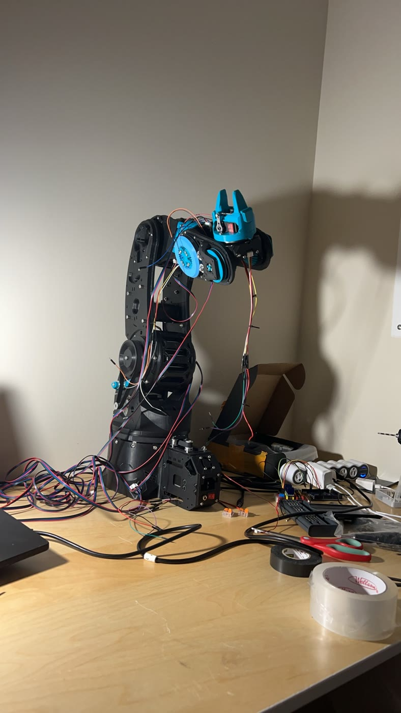
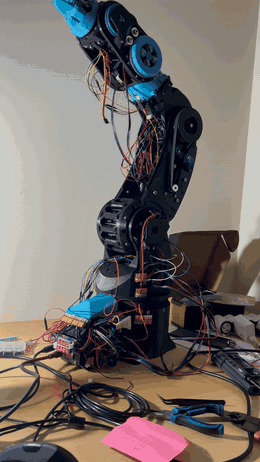
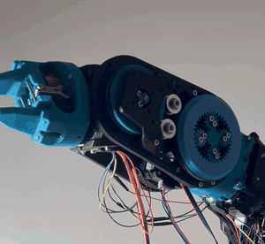
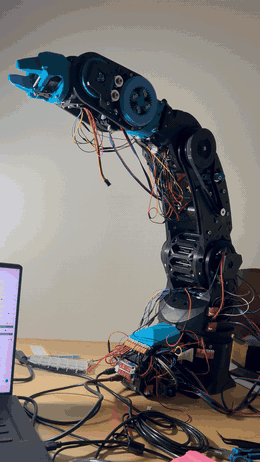
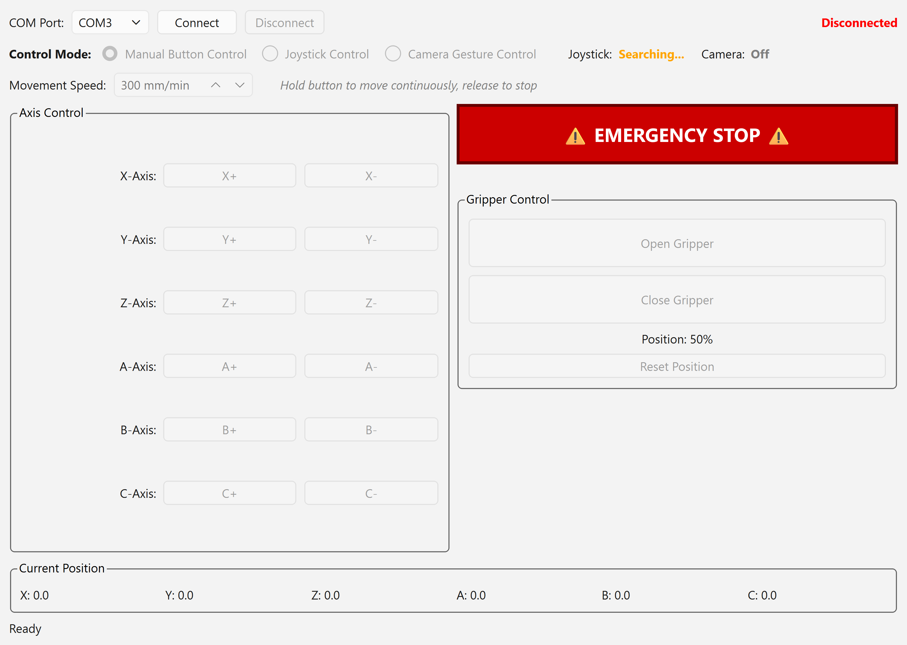
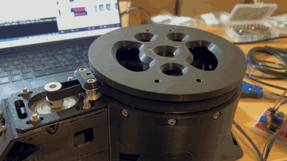
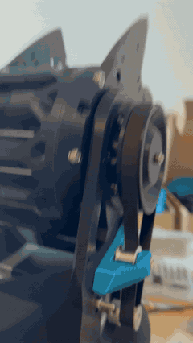
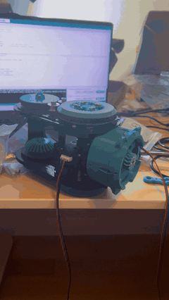
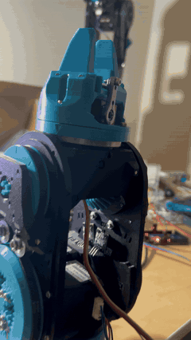

# Arctos Six-Axis Robotic Arm

A six-joint desktop robot arm, 3D printed from the open-source [Arctos](https://arctosrobotics.com/) design, that I assembled, wired and brought up at home in Winter 2026. An Arduino Mega running six-axis GRBL drives six stepper motors and a servo gripper, and a PyQt6 desktop app drives the arm with on-screen buttons, a USB gamepad, or hand gestures in front of a webcam.

  

<table>
  <tr>
    <td align="center" valign="top" width="33%">
      
       Lowering the gripper from a raised pose.
    </td>
    <td align="center" valign="top" width="33%">
      
       Gripper jaws opening.
    </td>
    <td align="center" valign="top" width="33%">
      
       Wrist tipping the gripper up.
    </td>
  </tr>
</table>

From a demo recorded on 14 March 2026, with the joints driven from a slider-based jog window. <a href="docs/media/video/full-arm-demo.mp4">Full clip</a> (720p download).

## What I did

- **Built it.** Assembled the kit and wired it: an Arduino Mega 2560, two stepper-driver shields, six steppers (two NEMA 23, four NEMA 17), nine hall-effect limit sensors, a servo gripper, and a 24 V supply with a 6 V buck converter for the servo.
- **Brought it up piece by piece.** Six small Arduino sketches tested the servo, both sensor types, a single stepper and a stepper pair before anything ran together.
- **Set up the firmware.** Flashed the vendor's six-axis GRBL and configured it over serial.
- **Debugged it on the real arm.** Found and corrected three joints that moved in reverse, two wrist buttons driving each other's motors, mismatched joint speeds, and a stream of jog commands that flooded GRBL's small buffer.

## Control app

  

- **Buttons:** hold to jog any of the six joints, gripper open and close, and a big emergency stop.
- **Gamepad:** the sticks and D-pad drive the joints; two face buttons work the gripper.
- **Hand gestures (experimental):** MediaPipe tracks both hands through the webcam, with a calibration step and a dry-run mode before anything moves. Tracking is still noisy.

## Bring-up clips

<table>
  <tr>
    <td align="center" valign="top" width="50%">
      
       Base turntable on its belt drive.
    </td>
    <td align="center" valign="top" width="50%">
      
       Shoulder joint swinging the upper arm.
    </td>
  </tr>
  <tr>
    <td align="center" valign="top" width="50%">
      
       Wrist gear module on the bench, one stepper.
    </td>
    <td align="center" valign="top" width="50%">
      
       Gripper servo test.
    </td>
  </tr>
</table>

## Not done yet

- **Homing.** The limit sensors are wired, but I never got their magnets positioned well enough for a reliable return-to-home.
- **Gesture control** runs, but hand capture is fuzzy, so it is not reliable yet.

## Repository

- [`arctos_control/`](arctos_control/): the desktop app. Run `pip install -r requirements.txt`, then `python main.py`.
- [`arduino_bringup_sketches/`](arduino_bringup_sketches/): the six bring-up sketches.
- [`docs/media/`](docs/media/): photos, GIFs and full-length MP4 clips.

The arm design and the GRBL firmware are by [Arctos Robotics](https://arctosrobotics.com/); their firmware and CAD files are not included here.
